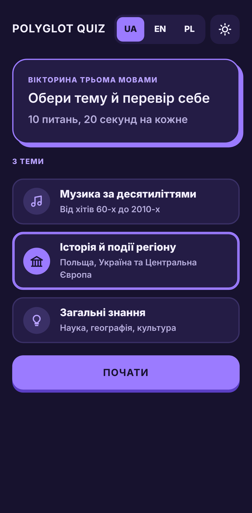

# Polyglot Quiz

A quiz game in **Ukrainian, English and Polish**, built as a QA portfolio project.
The game is the system under test; **the test suite is the main deliverable**.


| Light                                                                                             | Dark                                                                                            |
| ------------------------------------------------------------------------------------------------- | ----------------------------------------------------------------------------------------------- |
|  |  |

> Status: **milestone 0** (skeleton): home screen, topics API, test framework and CI.
> Quiz rounds, timer and leaderboard are next. See [`docs/DEVLOG.md`](docs/DEVLOG.md).

## What's tested and how

| Level           | Tool                      | Examples                                                                                                 |
| --------------- | ------------------------- | -------------------------------------------------------------------------------------------------------- |
| Unit            | Vitest                    | Language detection, theme logic, **locale files** (same keys and correct plural forms in every language) |
| API integration | Vitest + Fastify `inject` | Topics per language, validation errors, error format                                                     |
| API black-box   | Playwright `request`      | Contract checks with shared Zod schemas, negative cases                                                  |
| UI end-to-end   | Playwright                | Flows in all 3 languages, persistence after reload, dark mode, failure + retry with mocked API           |
| Cross-browser   | Playwright projects       | Chromium, Firefox, WebKit, Pixel 7, iPhone 15                                                            |
| CI              | GitHub Actions            | Format, lint, typecheck, unit/API tests, then Playwright with an HTML report artifact                    |

Highlights of the framework:

- **Page Object Model** with custom **fixtures** (`uiLang`, `uiTheme` options).
- **Language-independent tests**: UI text is read from the app's own locale files, so the same
  test runs in UA, EN and PL.
- **One contract** for app, API and tests: Zod schemas in `packages/shared`.
- QA docs: [test plan](docs/test-plan.md), [test cases](docs/test-cases/),
  [bug report template](docs/bug-reports/TEMPLATE.md).

## Tech stack

TypeScript · React 19 · Vite · i18next · Node.js 22 · Fastify · SQLite (`node:sqlite`) · Zod ·
Vitest · Playwright · GitHub Actions

## Project structure

```
apps/web        React frontend (feature folders, i18n, theme tokens)
apps/api        Fastify REST API + SQLite
packages/shared Zod schemas and types shared by everything
tests           Playwright: e2e/, api/, pages/, fixtures/, data/
docs            Test plan, test cases, bug reports, dev log
```

Details and conventions: [`CLAUDE.md`](CLAUDE.md).

## Run it locally

Requires Node.js 22.

```bash
npm install
npm run dev            # API on http://localhost:3000, web on http://localhost:5173
```

## Run the tests

```bash
npm test               # Vitest: unit + API integration
npx playwright install # once, downloads browsers
npm run test:e2e       # Playwright: starts the API and web app itself
npm run test:api       # Playwright API tests only
npx playwright show-report tests/playwright-report
```

## Credits

Fonts: [Nunito](https://fonts.google.com/specimen/Nunito) and
[Unbounded](https://fonts.google.com/specimen/Unbounded) (SIL Open Font License), via Google Fonts.
Icons are hand-drawn inline SVG.
