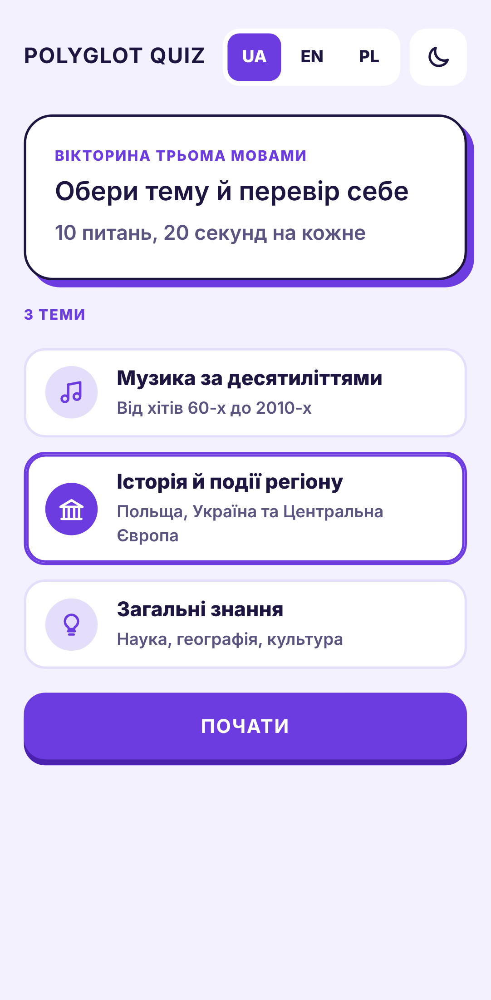
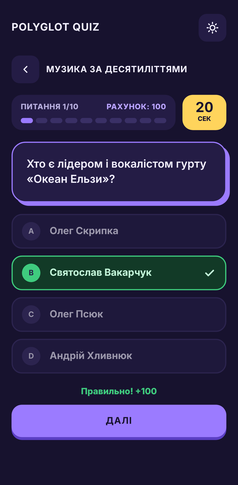

# Polyglot Quiz

A quiz game in **Ukrainian, English and Polish**, built as a QA portfolio project.
The game is the system under test; **the test suite is the main deliverable**.


| Home                                                                                   | Answer feedback                                                                              | Dark theme                                                                                       |
| -------------------------------------------------------------------------------------- | -------------------------------------------------------------------------------------------- | ------------------------------------------------------------------------------------------------ |
|  |  |  |

> **Status: expansion phase 4 of 10.** A dataset of 24k trilingual draft questions in 31
> categories is imported and validated. Players search and combine categories and
> subcategories or pick one of 20 themed quizzes; rounds, timer, server-side scoring and
> top-10 leaderboards per topic and per themed quiz work. Next: regions, difficulty, all
> eight question formats and five game modes ([plan](docs/EXPANSION_PLAN.md), [dev log](docs/DEVLOG.md)). Progress: [`docs/DEVLOG.md`](docs/DEVLOG.md).

## How the game works

1. Pick a language (UA / EN / PL). Then either build your own quiz (search the 31
   categories, select one or more, or open a category and pick subcategories) or start one
   of the **20 themed quizzes** (Back to the 80s, Millionaire Challenge, Pub Quiz, …).
2. Round settings (kept between visits): **region** (by language, worldwide, international
   only, Ukraine, Poland, Central Europe, English-speaking countries: a region means about a
   third of the questions are about it, the rest international), **difficulty** (Mixed,
   Easy, Medium, Hard) and **10/20/30/50 questions**. Questions played recently are avoided.
3. A round has up to **4 options** per question and **20 seconds** each (Millionaire
   Challenge: always 15 questions, easy to hard). A mix of categories gives every
   selected category an equal share, however big it is.
4. The server checks every answer: 100 points for a correct one, 0 for wrong or late.
5. The result screen shows points, correct answers and a verdict.
6. Save the result under a nickname to get on the **top-10 leaderboard** of the topic or
   themed quiz. Only standard rounds are ranked (10 questions, mixed difficulty); custom
   mixes aren't (players could otherwise pick only easy corners).
   The score is taken from the finished round on the server, so it can't be faked by the client.

The browser never receives the correct answers in advance: they come back only after the
player answers. The time limit is enforced on the server too (20 s + 2 s grace).

## What's tested and how

| Level           | Tool                      | Examples                                                                                                       |
| --------------- | ------------------------- | -------------------------------------------------------------------------------------------------------------- |
| Unit            | Vitest                    | Countdown math, answer states, language/theme logic, **locale files** (same keys, correct UA/PL plurals)       |
| Test data       | Vitest                    | **Question bank quality**: unique ids, enough questions per topic, every language filled, no duplicate options |
| API integration | Vitest + Fastify `inject` | Scoring, answer order, duplicates, **time limit with a fake clock** (incl. the exact grace boundary)           |
| API black-box   | Playwright `request`      | Contracts with shared Zod schemas, no answer leak, seeded reproducibility, negative cases                      |
| UI end-to-end   | Playwright                | Full rounds, wrong answers, **timer with `page.clock`**, Polish round, keyboard-only play, mocked failures     |
| Cross-browser   | Playwright projects       | Chromium, Firefox, WebKit, Pixel 7, iPhone 15                                                                  |
| CI              | GitHub Actions            | Format, lint, typecheck, Vitest, then Playwright with an HTML report artifact                                  |

Highlights of the framework:

- **Page Object Model** (`HomePage`, `QuizPage`, `ResultPage`, `LeaderboardPage`) with custom
  **fixtures** (`uiLang`, `uiTheme` options, a `QuizApi` client to set up state over HTTP).
- **Security rule tested on two levels**: the leaderboard score comes only from the server
  (a request carrying its own score is rejected).
- **Shared-state-safe black-box tests**: unique nicknames per test and invariant checks
  (sorted, consecutive ranks), so parallel workers can share one server.
- **Language-independent tests**: UI text is read from the app's own locale files, so the same
  test runs in UA, EN and PL.
- **Test oracle**: tests know the correct answers from the seed data, so they can play like a
  player who knows (or doesn't know) the answer.
- **Deterministic randomness**: a `seed` reproduces a round exactly; the server clock is
  injectable for time-limit tests.
- **One contract** for app, API and tests: Zod schemas in `packages/shared`.
- **Data validation as tests**: the 24k-record dataset is checked on every CI run (schema,
  structure, duplicates, enough questions per category, nothing withheld leaks into a round).
- **Database migration test**: a database from the previous release is migrated without
  losing played rounds or leaderboard entries.
- QA docs: [test plan](docs/test-plan.md), [test cases](docs/test-cases/),
  [bug reports](docs/bug-reports/) (incl. a real flaky-locator bug found with `--repeat-each`).

## API

| Method & path                     | Purpose                                                                                                                |
| --------------------------------- | ---------------------------------------------------------------------------------------------------------------------- |
| `GET /api/health`                 | Liveness check                                                                                                         |
| `GET /api/topics?lang=uk\|en\|pl` | Topics with names, descriptions and question counts                                                                    |
| `GET /api/catalog?lang=…`         | Categories with subcategories, and themed quizzes, with counts                                                         |
| `POST /api/rounds`                | Start a round `{ lang, topicId \| selection \| collectionId, region?, difficulty?, questionCount?, avoidIds?, seed? }` |
| `GET /api/leaderboard`            | Top 10 `?topicId=` or `?collectionId=` (or all boards)                                                                 |
| `POST /api/leaderboard`           | Save a finished ranked round `{ roundId, nickname }`                                                                   |
| `POST /api/rounds/:id/answers`    | Answer `{ questionId, optionId \| null }` → result and score                                                           |
| `POST /api/rounds/:id/next`       | Start the timer for the next question                                                                                  |
| `GET /api/rounds/:id`             | Round summary                                                                                                          |

Errors always have the shape `{ statusCode, error, message, details? }`.

## Content

|                            |                                                                                         |
| -------------------------- | --------------------------------------------------------------------------------------- |
| Records                    | 24,256 imported + 45 authored for this project (15 retired as duplicates)               |
| Categories                 | 31 (e.g. Music, History & Events, Movies & TV, Geography, Memes)                        |
| Served in English / Polish | 23,951 each                                                                             |
| Served in Ukrainian        | 2,866 (records with reviewed Ukrainian text; the rest is unrevised machine translation) |
| Verification               | **All drafts.** 499 answers externally confirmed, 22,571 still pending                  |

Full counts per category and language, and why records are withheld:
[`docs/CONTENT_REPORT.md`](docs/CONTENT_REPORT.md) (generated with `npm run content:report`).

**How a record gets into the game:** `content/` is validated on API start (schema, answer
key ↔ options, same options in every language, exact duplicates); review files decide per
language what is served. Withheld records are reported, never silently shown.

**Adding or fixing questions:** edit the category file in `content/questions/` (gzip JSONL,
schema in `packages/shared/src/content.ts`), run `npm run content:report` and the tests.

### Sources and licenses

- Code: [MIT](LICENSE).
- Content: [CC BY-SA 4.0](content/LICENSE.md) — most records are adapted from
  [OpenTriviaQA](https://github.com/uberspot/OpenTriviaQA) and
  [QuizBase](https://github.com/maciejdzierzek/quizbase-dumps-byasa) (both CC BY-SA 4.0);
  attribution is kept per record.
- All data sources and research references: [`content/DATA_SOURCES.md`](content/DATA_SOURCES.md),
  [`content/RESEARCH_SOURCES.md`](content/RESEARCH_SOURCES.md), license notices in
  [`content/licenses/`](content/licenses/). Sources are documentation for this repository
  only; the game itself has no sources screen.
- The brief for the expansion: [`content/AGENT_PROMPT.md`](content/AGENT_PROMPT.md),
  [`content/ORIGINAL_DESIGN_SPEC.md`](content/ORIGINAL_DESIGN_SPEC.md).

## Tech stack

TypeScript · React 19 · Vite · i18next · Node.js 22 · Fastify · SQLite (`node:sqlite`) · Zod ·
Vitest · Playwright · GitHub Actions

## Project structure

```
apps/web        React frontend (feature folders: quiz, topics, settings; i18n; theme tokens)
apps/api        Fastify REST API + SQLite; content importer in src/content/
content         Question dataset (CC BY-SA 4.0), policies, sources, licenses
packages/shared Zod schemas and types shared by everything
tests           Playwright: e2e/, api/, pages/, fixtures/, data/
docs            Test plan, test cases, bug reports, dev log, screenshots
```

Details and conventions: [`CLAUDE.md`](CLAUDE.md).

## Deployment

Free hosting: a static site and the API on **Render** (Frankfurt), the leaderboard in
**Neon** Postgres; described in [`render.yaml`](render.yaml). Setup, limits (the API sleeps
after 15 idle minutes) and architecture: [docs/DEPLOYMENT.md](docs/DEPLOYMENT.md).

## Run it locally

Requires Node.js 22.

```bash
npm install
npm run dev            # API on http://localhost:3000, web on http://localhost:5173
```

## Run the tests

```bash
npm test               # Vitest: unit + API integration
npx playwright install # once, downloads browsers
npm run test:e2e       # Playwright: starts the API and web app itself
npm run test:api       # Playwright API tests only
npx playwright show-report tests/playwright-report
```

## Credits

Fonts: [Nunito](https://fonts.google.com/specimen/Nunito) and
[Unbounded](https://fonts.google.com/specimen/Unbounded) (SIL Open Font License), via Google Fonts.
Icons are hand-drawn inline SVG. Questions are written for this project.
