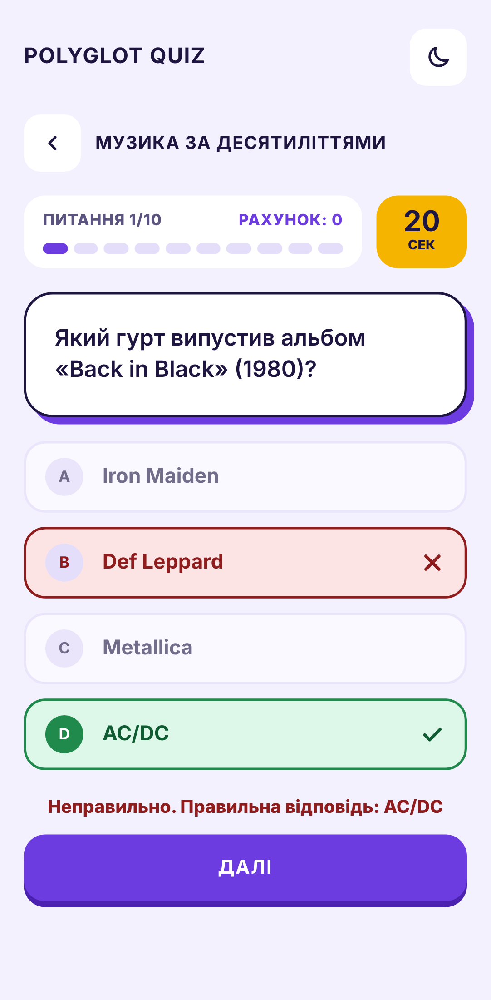

# Polyglot Quiz

A quiz game in **Ukrainian, English and Polish**, built as a QA portfolio project.
The game is the system under test; **the test suite is the main deliverable**.


| Home                                                                                   | Answer feedback                                                                              | Dark theme                                                                                       |
| -------------------------------------------------------------------------------------- | -------------------------------------------------------------------------------------------- | ------------------------------------------------------------------------------------------------ |
|  |  |  |

> **Status: milestone 1.** Playable rounds: 3 topics, 45 questions in 3 languages, 20 s timer,
> server-side scoring. Leaderboard and deployment are next. Progress: [`docs/DEVLOG.md`](docs/DEVLOG.md).

## How the game works

1. Pick a language (UA / EN / PL) and a topic.
2. A round is **10 random questions** with **4 options** each and **20 seconds** per question.
3. The server checks every answer: 100 points for a correct one, 0 for wrong or late.
4. The result screen shows points, correct answers and a verdict; play again or pick a new topic.

The browser never receives the correct answers in advance: they come back only after the
player answers. The time limit is enforced on the server too (20 s + 2 s grace).

## What's tested and how

| Level           | Tool                      | Examples                                                                                                       |
| --------------- | ------------------------- | -------------------------------------------------------------------------------------------------------------- |
| Unit            | Vitest                    | Countdown math, answer states, language/theme logic, **locale files** (same keys, correct UA/PL plurals)       |
| Test data       | Vitest                    | **Question bank quality**: unique ids, enough questions per topic, every language filled, no duplicate options |
| API integration | Vitest + Fastify `inject` | Scoring, answer order, duplicates, **time limit with a fake clock** (incl. the exact grace boundary)           |
| API black-box   | Playwright `request`      | Contracts with shared Zod schemas, no answer leak, seeded reproducibility, negative cases                      |
| UI end-to-end   | Playwright                | Full rounds, wrong answers, **timer with `page.clock`**, Polish round, keyboard-only play, mocked failures     |
| Cross-browser   | Playwright projects       | Chromium, Firefox, WebKit, Pixel 7, iPhone 15                                                                  |
| CI              | GitHub Actions            | Format, lint, typecheck, Vitest, then Playwright with an HTML report artifact                                  |

Highlights of the framework:

- **Page Object Model** (`HomePage`, `QuizPage`, `ResultPage`) with custom **fixtures**
  (`uiLang`, `uiTheme` options).
- **Language-independent tests**: UI text is read from the app's own locale files, so the same
  test runs in UA, EN and PL.
- **Test oracle**: tests know the correct answers from the seed data, so they can play like a
  player who knows (or doesn't know) the answer.
- **Deterministic randomness**: a `seed` reproduces a round exactly; the server clock is
  injectable for time-limit tests.
- **One contract** for app, API and tests: Zod schemas in `packages/shared`.
- QA docs: [test plan](docs/test-plan.md), [test cases](docs/test-cases/),
  [bug reports](docs/bug-reports/) (incl. a real flaky-locator bug found with `--repeat-each`).

## API

| Method & path                     | Purpose                                                      |
| --------------------------------- | ------------------------------------------------------------ |
| `GET /api/health`                 | Liveness check                                               |
| `GET /api/topics?lang=uk\|en\|pl` | Topics with names, descriptions and question counts          |
| `POST /api/rounds`                | Start a round `{ topicId, lang, seed? }` → 10 questions      |
| `POST /api/rounds/:id/answers`    | Answer `{ questionId, optionId \| null }` → result and score |
| `POST /api/rounds/:id/next`       | Start the timer for the next question                        |
| `GET /api/rounds/:id`             | Round summary                                                |

Errors always have the shape `{ statusCode, error, message, details? }`.

## Content

| Topic                 | Questions | Languages  |
| --------------------- | --------- | ---------- |
| Music by decade       | 15        | UA, EN, PL |
| History of the region | 15        | UA, EN, PL |
| General knowledge     | 15        | UA, EN, PL |

**Adding questions:** add an object to `apps/api/src/db/seed/questions.ts` (id like
`general-16`, the topic, the correct option, text and 4 options in all three languages) and
delete the local database file (`apps/api/data/quiz.db`) so it is re-seeded. The question-bank
tests check the new entry automatically. **Adding a topic:** add it to `topics.ts` with at
least 10 questions.

## Tech stack

TypeScript · React 19 · Vite · i18next · Node.js 22 · Fastify · SQLite (`node:sqlite`) · Zod ·
Vitest · Playwright · GitHub Actions

## Project structure

```
apps/web        React frontend (feature folders: quiz, topics, settings; i18n; theme tokens)
apps/api        Fastify REST API + SQLite; question bank in src/db/seed/
packages/shared Zod schemas and types shared by everything
tests           Playwright: e2e/, api/, pages/, fixtures/, data/
docs            Test plan, test cases, bug reports, dev log, screenshots
```

Details and conventions: [`CLAUDE.md`](CLAUDE.md).

## Run it locally

Requires Node.js 22.

```bash
npm install
npm run dev            # API on http://localhost:3000, web on http://localhost:5173
```

## Run the tests

```bash
npm test               # Vitest: unit + API integration
npx playwright install # once, downloads browsers
npm run test:e2e       # Playwright: starts the API and web app itself
npm run test:api       # Playwright API tests only
npx playwright show-report tests/playwright-report
```

## Credits

Fonts: [Nunito](https://fonts.google.com/specimen/Nunito) and
[Unbounded](https://fonts.google.com/specimen/Unbounded) (SIL Open Font License), via Google Fonts.
Icons are hand-drawn inline SVG. Questions are written for this project.
